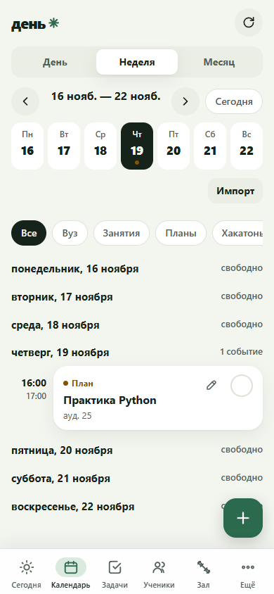
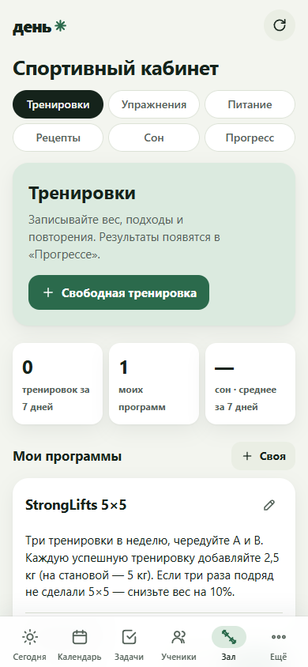
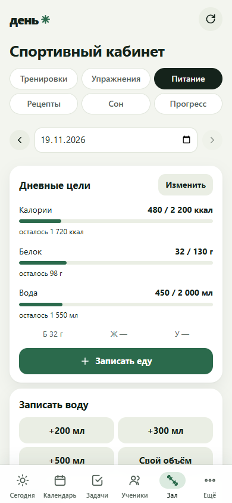

# День · планировщик в Telegram

Расписание, задачи и дневник тренировок в одном боте. События видны в чате и в Mini App. У каждого Telegram-аккаунта свой кабинет.

<p>
  
  
  
</p>

На скриншотах вымышленные записи.

| Раздел | Что можно делать |
| --- | --- |
| Календарь | День, неделя и месяц, разовые и повторяющиеся занятия, отметки посещения, импорт iCal |
| Задачи | Дедлайны, приоритеты, подзадачи, отметки выполнения, напоминания и недельная аналитика |
| Тренировки | Готовые и свои программы, анимации упражнений, журнал подходов, веса и повторений |
| Питание и сон | Цели по калориям, белку и воде, оценка КБЖУ по составу блюда, вода быстрыми кнопками, дневник сна |
| Ученики | Занятия по датам, ставки, суммы к оплате и прогноз дохода |

## Запуск на своём сервере

1. Создайте отдельного бота у [BotFather](https://t.me/BotFather).
2. Скопируйте `.env.example` в `.env`. Укажите токен, часовой пояс и HTTPS-адрес своего Mini App. Оставьте `BOT_MODE=public`.
3. Запустите `docker compose up -d --build`. Контейнер использует именованный том для данных, а веб-сервер слушает локальный порт `8765`.
4. Направьте свой HTTPS-домен на этот порт через обратный прокси. Пример для Caddy с доменом `calendar.example.org`.

   ```caddyfile
   calendar.example.org {
       reverse_proxy 127.0.0.1:8765
   }
   ```

5. Откройте бота и отправьте `/start`. Команда `/app` открывает Mini App, `/menu` показывает функции в чате, `/resume` включает регулярные уведомления.

При первом запуске у каждого пользователя пустой календарь. Секреты и данные кабинета хранятся отдельно от кода. Mini App определяет профиль по подписанным данным Telegram. Резервируйте именованный том перед обновлением.

## Импорт из Google и Apple Calendar

- **Google.** Откройте настройки нужного календаря и найдите раздел «Интеграция календаря». Скопируйте общедоступный или секретный адрес в формате iCal. Для секретных ссылок можно использовать форму в Mini App. [Инструкция Google](https://support.google.com/calendar/answer/37648)
- **Apple.** В приложении «Календарь» откройте «Календари» → ⓘ у нужного календаря iCloud → «Общедоступный календарь» → «Поделиться ссылкой». [Инструкция Apple](https://support.apple.com/guide/iphone/share-icloud-calendars-iph7613c4fb/ios)

Вставьте ссылку в чат с ботом или откройте **Календарь → Импорт** в Mini App. Импорт загружает события за последние 30 и следующие 180 дней. Повтор той же ссылки обновляет ранее загруженные события без дубликатов. Удаление или отмена в источнике не удаляет уже скопированное событие из бота.

## Проверка

```sh
python -m pip install -r requirements.txt
python -m unittest discover -s tests
```

Расписание вуза можно дополнительно подключить по ID группы [Cube](https://cube.nlabs.su/timetable?type=group). Прогноз использует [MET Norway](https://api.met.no/weatherapi/locationforecast/2.0/documentation) и [Open-Meteo](https://open-meteo.com/).
